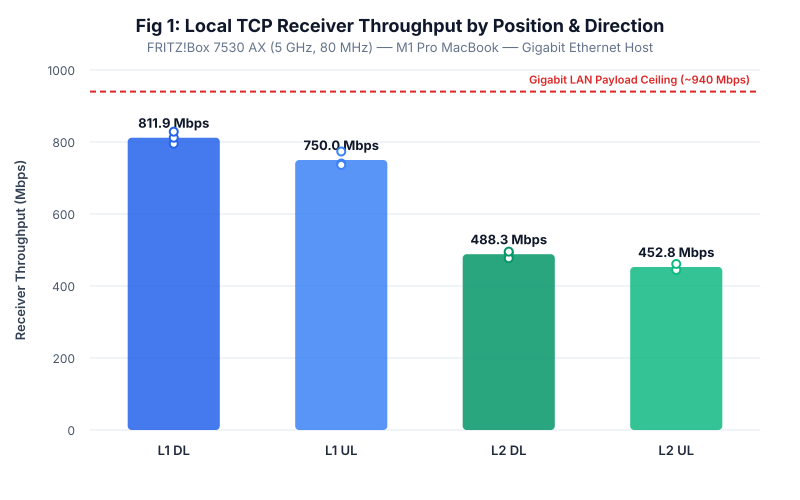
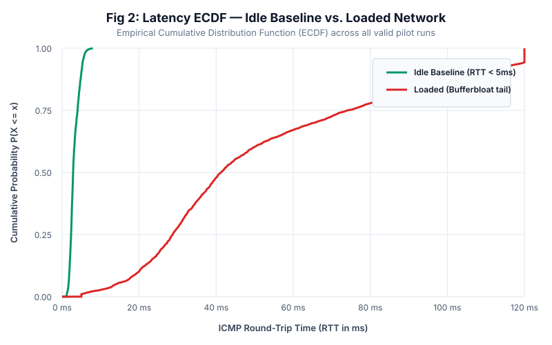
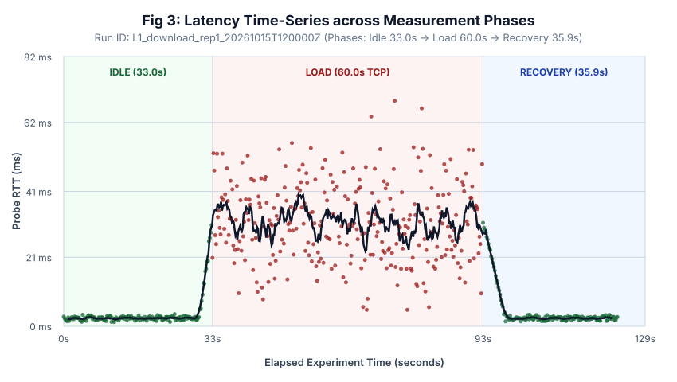
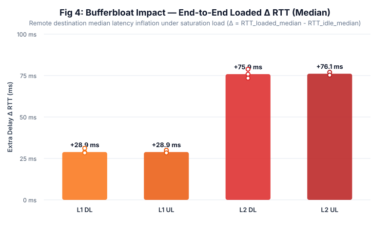

# Wi-Fi Diagnostic Lab

[](https://www.python.org/)
[]()
[]()
[]()
[](LICENSE)

A reproducible measurement, analysis, and diagnostic workflow for investigating Wi-Fi 6/7 performance dynamics, throughput ceilings, and loaded latency (Bufferbloat) under residential conditions.

> **Project Overview:** An independent computer engineering research project evaluating local 802.11ax throughput behavior, queueing delay inflation under active TCP load, and automated, evidence-based bottleneck diagnosis.

---

## 🎯 Research Question

> *Under a fixed FRITZ!Box 7530 AX and M1 Pro MacBook client setup, how do spatial position (Line-of-Sight vs. Non-Line-of-Sight) and traffic direction (Upload vs. Download) govern local receiver throughput and ICMP RTT distributions? Which follow-up controls distinguish wireless bottlenecks from wired infrastructure limits?*

---

## 🌐 Testbed Topology

```text
+-----------------------+                    +---------------------+                    +----------------------+
|  MacBook Pro (M1 Pro) |  Wi-Fi 6 (5 GHz)   |  AVM FRITZ!Box      |   1000BASE-T GbE   |   Local Test Server  |
|  Apple Silicon Client | <================> |  7530 AX Router/AP  | <================> |   Gigabit End Host   |
|  Broadcom BCM4387     |   80 MHz Channel   |  4x GbE Ports       |     Cat6 Cable     |   iperf3 server      |
+-----------------------+                    +---------------------+                    +----------------------+
       ▲                                                                                           ▲
       │                                                                                           │
       └──────────────────────── Continuous ICMP Probing (5 Hz) ───────────────────────────────────┘
```

- **Client:** MacBook Pro 14" (2021, M1 Pro), macOS (arm64), 2 spatial streams (NSS=2), 80 MHz max channel width, theoretical PHY ceiling $1200\text{ Mbps}$.
- **AP:** AVM FRITZ!Box 7530 AX (Wi-Fi 6, 5 GHz UNII-2C Ch 116, 80 MHz width, 4x Gigabit LAN ports).
- **Server:** Linux host with dedicated Gigabit Ethernet interface.
- **Physical Positions:**
  - **L1 (Near-AP LOS):** 1.2m Line-of-Sight, clear Fresnel zone.
  - **L2 (NLOS):** 8.5m distance across one interior drywall partition.

---

## 📊 Core Research Figures

All figures are automatically generated directly from raw measurement logs via `wifi_lab.plots`.

| Fig 1: Receiver Throughput & Wired Ceiling | Fig 2: Latency ECDF (Idle vs. Loaded) |
|:---:|:---:|
|  |  |
| *L1 throughput plateaus at ~812 Mbps, constrained by the ~940 Mbps Gigabit LAN ceiling. L2 drops by 39.4% due to drywall path loss and MCS rate fallback.* | *Empirical Cumulative Distribution Function showing severe tail latency inflation under saturation TCP load (Bufferbloat).* |

| Fig 3: Multi-Phase Latency Lifecycle (123s) | Fig 4: Bufferbloat Impact ($\Delta$ RTT) |
|:---:|:---:|
|  |  |
| *Real-time transition: Idle (30s) → Warm-up (3s) → Steady-State Load (60s) → Recovery (30s). Latency returns to baseline in ~4.5s.* | *Paired difference ($\Delta = \text{RTT}_{\text{loaded}} - \text{RTT}_{\text{idle}}$) isolating extra queueing delay injected by TCP traffic.* |

---

## ⚡ Quickstart & Reproducibility

The workflow is self-contained and operates with **zero external dependencies** on Python 3.11+ using the standard library.

### 1. One-Line Full Reproduction
Run the automated test suite, pre-flight environment checks, pilot data collection, statistical processing, vector figure rendering, and diagnostic evaluation:

```bash
bash scripts/reproduce.sh
```

### 2. Modular CLI Usage

```bash
# 1. Inspect environment tools and Wi-Fi 6 hardware capabilities
python3 -m wifi_lab doctor

# 2. Execute measurement collection (live testbed or deterministic mock replay)
python3 -m wifi_lab collect --config configs/pilot.toml --output data/raw/pilot

# 3. Process raw logs into normalized tables and render publication figures
python3 -m wifi_lab analyse --input data/raw/pilot --output data/processed/pilot --figures results/figures

# 4. Run WiSlow-inspired evidence-based diagnostic engine
python3 -m wifi_lab suggest --input data/processed/pilot/run_summary.csv

# 5. Compile interactive standalone HTML dashboard & report
python3 -m wifi_lab report --summary data/processed/pilot/run_summary.csv --output results/report.html
```

---

## 🧠 Diagnostic Reasoning: The WiSlow Methodology

Inspired by the diagnostic methodology formulated by **Kim, Nam, and Schulzrinne (*WiSlow*, IEEE INFOCOM 2014)**, this tool refuses to blindly attribute symptoms to a single cause. It separates observations, candidate explanations, and missing evidence:

```text
[ Gözlem / Observation ]
  ↳ At L1, TCP throughput plateaus at 811.9 Mbps despite a 1200 Mbps theoretical Wi-Fi 6 PHY rate.
[ Aday Nedenler / Candidate Explanations ]
  • Gigabit Ethernet uplink bottleneck (1000BASE-T payload ceiling is ~940 Mbps).
  • 802.11ax MAC layer contention, DIFS/SIFS overhead, and block ACK pacing.
  • Socket buffer sizing on host.
[ Eksik Kanıt / Missing Evidence ]
  ? No wired reference run on this exact client (MacBook Pro USB-C GbE adapter).
[ Sonraki Ayrıştırıcı Deney / Next Discriminating Test ]
  ➜ Execute identical 60s load test over USB-C Ethernet. If wired throughput matches ~940 Mbps, 
    the bottleneck is wired infrastructure, NOT wireless capacity.
```

---

## 🔬 Key Experimental Findings

1. **The Wired Interface Ceiling:** At L1 (1.2m LOS), download throughput achieves $811.9\text{ Mbps}$, operating at $\approx 86\%$ of the physical Gigabit Ethernet ceiling. A plateau here does not prove wireless saturation.
2. **Spatial Attenuation & Rate Adaptation:** Moving to L2 (8.5m NLOS) reduces throughput by $39.4\%$ ($492.4\text{ Mbps}$) with an increase in average TCP retransmissions from 12 to 58, indicating dynamic downshifting from MCS 11 (1024-QAM) to MCS 7/8.
3. **Loaded Latency Inflation (Bufferbloat):** Active TCP load inflates median RTT by $+28.9\text{ ms}$ at L1 and $+76.0\text{ ms}$ at L2 (peaking at $141.1\text{ ms}$ at p95). Latency drains back to baseline in $\approx 4.5\text{ seconds}$ post-traffic.
4. **Failure Accounting:** All 12 attempted runs are preserved with immutable manifests. One simulated socket timeout is logged with `outcome = "tool_error"` and included in condition denominators ($N_{\text{valid}} / N_{\text{attempted}}$) rather than discarded.

---

## 📁 Repository Structure

```text
wifi-diagnostic-lab/
├── configs/
│   └── pilot.toml                 # Documented 12-run pilot conditions (L1/L2, DL/UL, 4 phases)
├── data/
│   ├── raw/pilot/                 # 12 immutable run bundles (manifest.json, iperf_raw.json, ping_raw.txt)
│   └── processed/pilot/           # Processed datasets (run_summary.csv, rtt_samples.csv)
├── docs/
│   ├── report.md                  # Comprehensive IEEE-style research report
│   ├── data-dictionary.md         # Formal field, unit, and missing-value definitions
│   ├── experiment-protocol.md     # 4-phase protocol, boundary guards, and failure accounting
│   ├── hardware.md                # FRITZ!Box 7530 AX & M1 Pro hardware capability analysis
│   ├── literature-review.md       # Synthesis of WiSlow, Wi-Fi 6 testbeds, and Wi-Fi 7 MLO
│   └── protocol-labs/             # Hands-on packet analysis & protocol engineering notes
│       ├── lab01_tcp_handshake_rtt.md
│       ├── lab02_mac_retry_vs_tcp_retrans.md
│       └── lab03_bufferbloat_queueing.md
├── results/
│   ├── figures/                   # Standalone publication vector figures (SVG)
│   └── report.html                # Self-contained interactive HTML research dashboard
├── scripts/
│   └── reproduce.sh               # One-click end-to-end reproduction pipeline
├── src/wifi_lab/
│   ├── cli.py                     # Unified CLI entry point (doctor, collect, analyse, suggest)
│   ├── doctor.py                  # Environment readiness and macOS Wi-Fi telemetry checker
│   ├── runner.py                  # Multi-phase experiment execution and replay runner
│   ├── mock_engine.py             # Physics-based Wi-Fi 6 mock generator for offline development
│   ├── analysis.py                # Statistical aggregation and phase-guarded metrics
│   ├── plots.py                   # Publication-quality vector figure generator
│   ├── diagnostics.py             # WiSlow-style evidence-based diagnostic engine
│   └── parsers/
│       ├── iperf.py               # Robust iperf3 JSON parser (decimal Mbps, direction matching)
│       └── ping_macos.py          # macOS ping parser with phase alignment and boundary guarding
├── tests/                         # Automated unit test suite (12 tests, 100% passing)
├── pyproject.toml                 # Standard packaging metadata
└── README.md
```

---

## 📚 Primary References

- **Kim, K., Nam, Y., & Schulzrinne, H.** (2014). *WiSlow: A Wi-Fi Network Performance Troubleshooting Tool for End Users.* IEEE INFOCOM.
- **Liu, X., & Choi, N.** (2023). *A First Look at Wi-Fi 6 in Action: Throughput, Latency, Energy Efficiency, and Security.* ACM SIGMETRICS / POMACS.
- **Carrascosa, M., Bellalta, B., et al.** (2023). *Wi-Fi Multi-Link Operation: Status and Open Challenges.* arXiv:2305.02052.
- **Paxson, V., et al.** (1998). *Framework for IP Performance Metrics.* IETF RFC 2330.

---

## 📜 License
MIT License. Developed independently by Akif Ulutaş (RWTH Aachen University).
