# Wi-Fi Diagnostic Lab & Bufferbloat Localization Engine

[](https://www.python.org/)
[]()
[]()
[]()
[]()
[]()
[](LICENSE)

An open-source diagnostic and measurement project investigating **Wi-Fi 6 throughput dynamics**, **loaded latency (Bufferbloat)**, and **bottleneck localization under constrained edge vantage points**.

> **Project Context:** Wi-Fi Diagnostic Lab is an independent learning project I started while studying wireless networking and network measurement. Using my home network, I built small Python experiments to compare latency under idle and loaded conditions and practise processing and visualising measurement data. The repository also contains experimental extensions for controlled network scenarios and simplified queue simulations. My goal is to connect concepts from my reading with practical observations, understand the limitations of the measurements, and improve the implementation as I learn.

---

## 📑 Table of Contents

- [Motivation & Problem Statement](#-motivation--problem-statement)
- [Key Empirical Findings (Live Hardware)](#-key-empirical-findings-live-hardware)
- [System Architecture](#-system-architecture)
- [Differential Path Algebra & Inference Theory](#-differential-path-algebra--inference-theory)
- [Controlled Reference Lab & Counterexamples](#-controlled-reference-lab--counterexamples)
- [Quickstart & Usage](#-quickstart--usage)
- [Publication Figures & Visualizations](#-publication-figures--visualizations)
- [Verification & Test Pyramid](#-verification--test-pyramid)
- [Data Provenance & Privacy Ethics](#-data-provenance--privacy-ethics)
- [Academic Context & About the Author](#-academic-context--about-the-author)
- [Scientific References](#-scientific-references)

---

## 🎯 Motivation & Problem Statement

Conventional network speed tests and diagnostic utilities often evaluate performance from a single client endpoint to a cloud server, observe elevated round-trip times under load (Bufferbloat), and assign a single cause without distinguishing intermediate network hops.

In residential edge networks, loaded latency can arise in distinct physical segments:
1. **The Wireless Access Link:** Dynamic 802.11 rate adaptation (MCS fallback) caused by path loss or obstacle attenuation increases transmission airtime per frame, backing up packets in the AP transmission queue.
2. **The Residential Gateway:** Egress traffic shaping, CPU load, or buffer limits in customer-premises equipment (CPE).
3. **The Upstream WAN Link:** Drop-tail FIFO buffers at DSLAMs, CMTS, or ISP access nodes.

**Project Goal:**  
Rather than guessing a single root cause when evidence is incomplete, this project explores a **set-valued, abstention-capable localization model**. When edge vantage points are insufficient to disambiguate the bottleneck, the engine retains uncertainty (e.g. candidate region set $\mathcal{R}_{\text{cand}} = \{\text{near}, \text{gateway}\}$ with `not_excluded_regions = ["near_link", "gateway_node"]` and `abstained = True`) and suggests an informative subsequent measurement (such as deploying a wired observer tap) to resolve ambiguity.

---

## 🔬 Key Empirical Findings (Live Hardware)

Live residential experiments were conducted on **macOS (Darwin arm64)** using an **Apple Silicon M1 Pro client** connected to an **AVM FRITZ!Box 7530 AX Access Point** (5 GHz UNII-2C, Channel 48, 80 MHz channel width, 802.11ax) across two spatial configurations:
- **Position 1 (L1: Near AP, Line-of-Sight):** 1.2 m distance, clear line-of-sight.
- **Position 2 (L2: Adjacent Room, Non-Line-of-Sight):** 8.5 m distance, obstructed by interior drywall.

### Measured Telemetry & Working Observations

> [!NOTE]
> **Observation vs. Explanation:** The metrics below distinguish between direct empirical measurements (telemetry) and the inferred physical explanations (hypotheses). Synthetic calibration runs (~812 Mbps) are kept strictly separate from residential measurements (~47 Mbps).

| Metric | Position 1 (L1: LOS, 1.2m) | Position 2 (L2: NLOS, 8.5m) | Empirical Observation vs. Physical Hypothesis |
| :--- | :---: | :---: | :--- |
| **Physical RSSI / Noise** | **-52 dBm / -88 dBm** | **-72 dBm / -89 dBm** | *Observation:* 20 dB RF path loss through drywall partition |
| **Signal-to-Noise Ratio (SNR)** | **36 dB** | **17 dB** | *Observation:* 19 dB reduction in signal-to-noise ratio |
| **802.11ax MCS Rate** | **MCS 10** (1024-QAM) | **MCS 2** (QPSK) | *Hypothesis:* AP dynamic rate adaptation falls back to robust modulation |
| **Physical Link Capacity** | **1134.0 Mbps** | **136.0 Mbps** | *Observation:* 88% reduction in negotiated PHY link rate |
| **Measured Download Throughput** | **47.0 Mbps** | **43.3 Mbps** | *Observation:* Residential internet plan limit (~50 Mbps subscription tier) |
| **Idle Wi-Fi RTT (p95)** | **4.4 ms** | **4.3 ms** | *Observation:* Unloaded baseline latency is virtually identical across locations |
| **Loaded Wi-Fi RTT (p95)** | **58.5 ms** | **118.9 ms** | *Observation:* 2x queue latency inflation observed under active TCP load |
| **Wi-Fi Hop Bloat ($\Delta RTT_{\text{wifi}}$)** | **+54.1 ms** | **+114.6 ms** | *Hypothesis:* Increased frame airtime at MCS 2 backs up AP transmission queue |
| **WAN Access Bloat ($\Delta RTT_{\text{wan}}$)** | **+43.9 ms** | **+13.4 ms** | *Observation:* Remote hop delay elevation under upstream saturation |
| **Total End-to-End Bloat** | **+98.0 ms** | **+128.0 ms** | *Observation:* Total round-trip time inflation observed by edge client |
| **Localization Candidate Set** | `{near_link, far_link}` | `{near_link, far_link}` | *Engine Output:* Multi-hop delay elevation observed on both local hop and WAN |

> **Key Observation:** An unloaded ping test does not reveal wireless rate adaptation: idle RTT at L2 is ~4.3 ms (identical to L1). Under active TCP load generation, latency elevation was empirically observed on the local gateway hop (+114.6 ms at L2 vs. +54.1 ms at L1), coinciding with a reduced PHY rate (MCS 2). Additional controlled trials in an isolated chamber are required to isolate the exact queue contribution from contending interference and operating system scheduling delays.

Raw time-series telemetry and immutable manifests with SHA-256 digests are archived in:  
[`data/raw/live_home_runs/`](data/raw/live_home_runs/)

---

## 🏛️ System Architecture

The codebase unifies two complementary experimental environments into a single coherent Python package:

```mermaid
flowchart TD
    subgraph Empirical ["1. Empirical Residential Telemetry (wifi_lab)"]
        LiveScript["scripts/live_home_test.py"] -->|Dual-Vantage Probing| LiveRuns["data/raw/live_home_runs/"]
        LiveRuns -->|Ingest probes.csv| WiFiAnalysis["wifi_lab.analysis"]
        WiFiAnalysis --> WiFiSummary["data/processed/live_home/"]
        WiFiAnalysis --> Figures["results/figures/live_home/*.svg"]
        WiFiSummary --> WiSlowRules["wifi_lab.diagnostics (WiSlow Rules)"]
        MLOSim["wifi_lab.mlo_sim"] --> MLOFig["results/figures/fig5_mlo_vs_single_link.svg"]
    end

    subgraph Controlled ["2. Controlled Reference Lab (bll)"]
        BLLCLI["bll CLI (doctor, run, infer, export, report)"]
        BLLTopology["Linux 6-Node Netns Topology (ip netns + tc)"]
        BLLMeasurements["Concurrent Measurement Engine (iperf3 + ping)"]
        BLLStorage["DuckDB Analytical Storage (Parquet Tables)"]
        BLLInference["Deterministic Set-Valued Inference Engine"]
        BLLBenchmark["Double-Blind Benchmark Evaluator"]
        BLLRedactor["Privacy Redactor & Data Sanitization (HTML Report)"]

        BLLCLI --> BLLTopology
        BLLTopology --> BLLMeasurements
        BLLMeasurements --> BLLStorage
        BLLStorage --> BLLInference
        BLLInference --> BLLBenchmark
        BLLInference --> BLLRedactor
    end
```



### Directory Structure

```text
wifi-diagnostic-lab/
├── src/
│   ├── wifi_lab/                  # Wi-Fi Diagnostic Suite (WiSlow-inspired)
│   │   ├── cli.py                 # CLI interface: doctor, collect, analyze, suggest, mlo-sim, report
│   │   ├── runner.py              # Multi-phase execution and offline replay engine
│   │   ├── analysis.py            # Dual-format statistical parser (probes.csv & raw iperf/ping)
│   │   ├── diagnostics.py         # WiSlow evidence-based diagnostic decision trees
│   │   ├── mlo_sim.py             # Wi-Fi 7 (802.11be) Multi-Link Operation queue simulator
│   │   └── redactor.py            # RFC 2330 pseudonymization and hashing engine
│   └── bll/                       # Bufferbloat Localization Lab (Reference System)
│       ├── cli.py                 # bll CLI: doctor, lab, run, infer, export, report, evaluate
│       ├── topology/              # 6-node netns topology & longest prefix match (LPM) verification
│       ├── helper/                # Hardened JSON-RPC privileged helper daemon
│       ├── measurements/          # Concurrent iperf3 saturation + ping probe engine
│       ├── storage/               # DuckDB analytical layer over immutable Parquet tables
│       ├── inference/             # Differential path algebra & set-valued abstention
│       └── evaluation/            # Counterexample benchmark & hypothesis testing (H1, H2, H3)
├── scripts/
│   ├── live_home_test.py          # Standalone macOS dual-vantage live home test runner
│   └── reproduce.sh               # One-click automated reproduction script
├── data/
│   ├── raw/live_home_runs/        # Empirical physical residential Wi-Fi 6 measurement runs
│   ├── raw/pilot/                 # Synthetic reference pilot runs for pipeline calibration
│   └── processed/                 # Normalized run summary and sample time-series CSVs
├── results/
│   └── figures/                   # Publication-quality vector figures (SVG)
├── tests/                         # 196 Unit, contract, invariant & fault injection tests
└── e2e_tests/                     # 286 End-to-End acceptance tests across Milestones 1–7
```

---

## 📐 Differential Path Algebra & Inference Theory

The inference engine operates on path-level latency inflation under active load compared to an uncontended baseline:

$$\Delta RTT(p) = RTT_{\text{load}, p95}(p) - RTT_{\text{idle}, \text{med}}(p)$$

### Multi-Path Latency Decomposition
In a dual-vantage residential setting:
- **Path 1 (Local Wireless Hop):** $\text{Client} \to \text{Gateway}$
  $$\text{Bloat}_{\text{wifi}} = \Delta RTT(\text{Client} \to \text{Gateway})$$
- **Path 2 (End-to-End Path):** $\text{Client} \to \text{Remote WAN}$
  $$\text{Bloat}_{\text{wan}} = \Delta RTT(\text{Client} \to \text{Remote}) - \Delta RTT(\text{Client} \to \text{Gateway})$$

### Vantage Profiles & Mathematical Abstention

The inference engine strictly honors the observation capability of the vantage configuration without hallucinating labels:

| Vantage Profile | Available Observation Paths | Supported Regions | Inconclusive / Candidate Regions ($\mathcal{R}_{\text{cand}}$) | Abstention Verdict | Recommended Action |
| :--- | :--- | :--- | :--- | :---: | :--- |
| `remote_only` | $\text{Client} \to \text{Remote}$ | `[]` | `[near_link, gateway_node, far_link]` | `True` | `deploy_dual_vantage_probes` |
| `gateway_remote` | $\text{Client} \to \text{Gateway}$, $\text{Client} \to \text{Remote}$ | `[near_link]` or `[far_link]` | `[gateway_node]` (egress vs ingress) | Depends on $\Delta RTT$ | `deploy_wired_observer_tap` |
| `full_observer` | $\text{Client} \to \text{GW}$, $\text{Client} \to \text{Remote}$, $\text{Observer} \to \text{Remote}$ | Exact Region Isolated | `[]` | `False` | Disambiguation complete |

> **Zero Label Leakage Guarantee:** The inference engine strictly inspects measured delay metrics from `samples/ping.parquet` (or `probes.csv`) via DuckDB SQL. It never inspects scenario identifiers, configuration metadata, or ground-truth files during inference.

---

## 🧪 Controlled Reference Lab & Counterexamples

To validate inference reliability, BLL includes a double-blind counterexample benchmark comprising **12 controlled reference scenarios**:

1. `healthy_baseline`: Pristine link with zero induced queueing.
2. `residential_dsl_near_fifo`: Bufferbloat induced strictly at the customer access link (`q_near`).
3. `cable_asymmetric_far_fifo`: Bufferbloat induced at the remote ISP access link (`q_far`).
4. `dual_fifo_contention`: Compound bufferbloat present simultaneously on near and far links.
5. `fixed_propagation_delay_control`: Satellite/propagation delay without packet queueing (validates that fixed delay is not misclassified as bufferbloat).
6. `random_loss_without_queue`: High packet loss without queue buildup (validates loss independence).
7. `endpoint_cpu_bottleneck`: Host CPU saturation simulating processing delay.
8. `aqm_active_fq_codel`: Active Queue Management keeping loaded delay bounded under saturation.
9. `aqm_active_cake`: CAKE queue discipline with bandwidth shaping.
10. `indistinguishable_access_vs_gateway`: Demonstrates legitimate mathematical abstention under missing observer tap.
11. `bursty_cross_traffic`: Transient bursts testing filter resilience.
12. `reverse_path_asymmetry`: Asymmetric routing testing bidirectional delay decomposition.

### Statistical Release Criteria
The benchmark evaluator computes empirical metrics over all reference runs:
- **Conditional Localization Error (CLE):** $\text{CLE} \le 0.10$ (Zero false claims when non-abstained).
- **Region-Set Coverage (RSC):** $\text{RSC} \ge 0.95$ (True bottleneck included in candidate set $\ge 95\%$ of cases).
- **Negative Control False Positive Rate (FPR):** $\text{FPR} \le 0.05$ (Healthy baseline correctly classified as unbloated).

---

## ⚡ Quickstart & Usage

### 1. Installation

Install via standard virtual environment or [uv](https://github.com/astral-sh/uv):

```bash
# Clone the repository
git clone https://github.com/Akifulutas/wifi-diagnostic-lab.git
cd wifi-diagnostic-lab

# Create and activate virtual environment
python3 -m venv .venv
source .venv/bin/activate

# Install with development and analysis dependencies
pip install -e ".[dev,analysis]"
```

### 2. Verify System Preflight

```bash
# Check Wi-Fi diagnostic environment
wifi-lab doctor

# Check Bufferbloat Localization Lab backend and tool readiness
bll doctor --json
```

### 3. Run Live Residential Probing (macOS / Linux)

Execute a 30-second 3-phase dual-vantage test (8s Idle $\to$ 15s Load $\to$ 7s Recovery) measuring local gateway RTT vs. remote WAN RTT:

```bash
# Near router (Line-of-Sight)
python3 scripts/live_home_test.py --position L1 --idle 8 --load 15 --recovery 7

# Move to an adjacent room (Non-Line-of-Sight)
python3 scripts/live_home_test.py --position L2 --idle 8 --load 15 --recovery 7
```

### 4. Process Live Runs into Publication Figures

```bash
wifi-lab analyze data/raw/live_home_runs \
  --output-dir data/processed/live_home \
  --figures-dir results/figures/live_home
```

### 5. Run Controlled Benchmark & Generate Static HTML Report

```bash
# Execute counterexample run via simulation backend
bll run --backend mock_simulation --scenario residential_dsl_near_fifo --out-dir runs

# Execute deterministic inference engine on run
bll infer runs/<run_id>

# Export sanitized dataset with MAC, IPv4, and hostname scrubbing
bll export runs/<run_id> --out-dir export/redacted_dataset --redact

# Generate zero-CDN offline HTML report
bll report runs/<run_id> --out results/bll_report.html

# Evaluate double-blind benchmark suite across scenarios
bll evaluate --runs-dir runs --ground-truth-dir ground_truth --json
```

---

## 📊 Publication Figures & Visualizations

The automated analysis pipeline generates publication-ready vector figures (SVG) directly from measured telemetry:

| Figure | Description | Key Insight |
| :--- | :--- | :--- |
| **[Figure 1](results/figures/live_home/fig1_throughput_by_condition.svg)** | Throughput by Condition & Direction | L1 reaches ~47.0 Mbps; L2 reaches ~43.3 Mbps on home internet tier. (Pilot calibration reaches ~812 Mbps). |
| **[Figure 2](results/figures/live_home/fig2_rtt_ecdf.svg)** | Latency Empirical CDF | Bifurcation between idle baseline (< 5 ms) and loaded saturation (> 80 ms). |
| **[Figure 3](results/figures/live_home/fig3_rtt_timeseries.svg)** | Dynamic 3-Phase Time-Series Dynamics | Shows idle baseline (~8s), active load ramp (~15s), and buffer drain recovery (~8s) with real relative timestamps. |
| **[Figure 4](results/figures/live_home/fig4_loaded_delta_rtt.svg)** | Loaded $\Delta RTT$ (Bufferbloat Impact) | Plots end-to-end median loaded $\Delta RTT$ to remote destination (+32.3 ms at L1, +44.0 ms at L2); local gateway hop exhibits +54.1 ms (L1) and +114.6 ms (L2) p95 queue elevation. |
| **[Figure 5](results/figures/fig5_mlo_vs_single_link.svg)** | Wi-Fi 7 MLO Simulation | Compares Single-Link 5 GHz vs. MLO (2.4 GHz + 5 GHz) queueing latency reduction. |

---

## 🛡️ Verification & Test Pyramid

The repository enforces software engineering and test determinism rules:

```bash
# 1. Unit, Contract, Invariant & Fault Injection Tests (196 tests)
pytest tests/

# 2. End-to-End Acceptance Suite across Milestones 1–7 (286 tests)
python3 e2e_tests/run_e2e.py

# 3. Privacy & Secret Leakage Audit
gitleaks git .
```

**Verification Results:**
- **Unit & Contract Tests:** 196 passed (100% pass rate in ~13s).
- **End-to-End Acceptance Tests:** 285 passed, 1 skipped (requires native Linux `ip netns`), 0 failed.
- **Security & Secrets Scan:** Zero credentials, private keys, or tokens committed.

---

## 🔒 Data Provenance & Privacy Ethics

To protect network privacy while maintaining data utility for open evaluation:
1. **Explicit Data Separation:** Synthetic pilot calibration runs (`data/raw/pilot/`) are kept strictly separate from real physical residential measurements (`data/raw/live_home_runs/`).
2. **Deterministic Pseudonymization:** `bll export --redact` scrubs all MAC addresses (`02:00:00:xx:xx:xx`), maps local IPv4 addresses to the RFC 5737 documentation prefix (`192.0.2.0/24`), masks device hostnames (`redacted-host.local`), and sanitizes Wi-Fi SSIDs while preserving relative timestamps and mathematical $\Delta RTT$ relationships.
3. **Integrity Manifests:** Every run directory includes an immutable `manifest.json` recording SHA-256 digests over all raw logs and analytical tables.

---

## 🎓 About the Author & Project Background

This project was developed by **Akif Ulutaş**, an undergraduate student at **RWTH Aachen University**.

- **Motivation:** Developed as a practical learning project to explore network performance analysis, loaded latency, and differential telemetry processing on real devices.
- **UROP Context:** Created as an independent engineering portfolio project in preparation for the **Undergraduate Research Opportunities Programme (UROP)**. It reflects an enthusiasm for computer networks, clean modular code, automated testing, and a hands-on approach to connecting textbook principles with real-world observations.

---

## 📚 Scientific References

1. **Kim, K., Nam, Y., & Schulzrinne, H.** (2014). *WiSlow: A Wi-Fi Network Performance Troubleshooting Tool for End Users.* IEEE INFOCOM.
2. **Nichols, K., & Jacobson, V.** (2012). *Controlling Queue Delay (CoDel).* ACM Queue, 10(5), 20–34.
3. **Høiland-Jørgensen, T., Hurtig, P., & Brunstrom, A.** (2014). *The Flent Network Testing Tool.* Netdev 0.1.
4. **Gettys, J., & Nichols, K.** (2011). *Bufferbloat: Dark Buffers in the Internet.* Communications of the ACM, 55(1), 57–65.
5. **Paxson, V., Almes, G., Mahdavi, J., & Mathis, M.** (1998). *Framework for IP Performance Metrics.* IETF RFC 2330.
6. **Almes, G., Kalidindi, S., & Zekauskas, M.** (1999). *A One-way Delay Metric for IPPM.* IETF RFC 2679 / RFC 3393.
7. **Carrascosa, M., Bellalta, B., et al.** (2023). *Wi-Fi Multi-Link Operation: Status and Open Challenges.* IEEE Communications Magazine, 61(12).

---

## 📜 License

MIT License. Copyright (c) 2026 Akif Ulutaş (RWTH Aachen University). See [LICENSE](LICENSE) for details.
